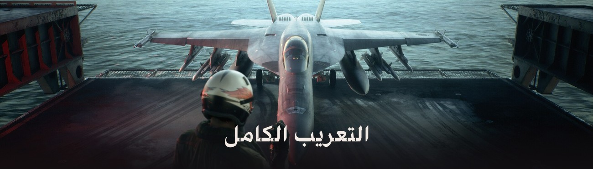

# ACE COMBAT 8 - التعريب الكامل

تعريب كامل لـACE COMBAT 8: Wings of Theve على Steam بالعربية الفصحى وبنبرة عسكرية: 51,256 سطرًا بترجمة عن النص الياباني، تشمل محادثات اللاسلكي أثناء الطيران، والقوائم وشاشة الطيران، والمشاهد السينمائية، وإحاطات المهمات، بخط اليمامة.

## التحميل

من صفحة [الإصدارات](../../releases/latest) حمّل ملف `AceCombat8-Arabic-v1.0.0.exe`.

## التثبيت

1. أغلق اللعبة.
2. شغّل المثبّت واضغط «تثبيت اللغة العربية». يجد المثبّت اللعبة تلقائيًا من مكتبة Steam، ويمكنك اختيار مجلدها يدويًا.
3. يضيف المثبّت كل ما يلزم: التعريب، ومحمّل المودات، واختصارًا على سطح المكتب باسم «ACE COMBAT 8 - عربي».
4. **شغّل اللعبة دائمًا من اختصار سطح المكتب** وستبدأ بالعربية.

> زر Play في Steam يشغّل اللعبة الأصلية بالإنجليزية مع نظام مكافحة الغش، للعب عبر الإنترنت. للعربية استخدم اختصار سطح المكتب.

إن ظهرت رسالة "Windows protected your PC" اضغط More info ثم Run anyway.

للإزالة: شغّل المثبّت واضغط «إزالة اللغة العربية».

## ما يميّز هذا التعريب

- **مصطلحات طيران حقيقية:** كل مصطلح رُوجع على ما تستخدمه القوات الجوية العربية ومراجع الطيران العربية، مثل «انهيار» لفقدان الرفع، و«الحارق اللاحق»، و«رجل الجناح»، و«قتال جوي قريب».
- **شاشة طيران مضبوطة للعربية:** أسماء الأسلحة مختصرة لتتسع بجانب عدد الذخيرة، والوقت والنقاط بالترتيب العربي، وعمود الأسلحة مرفوع حتى لا يغطي أيقونة الطائرة.
- **أسماء موحّدة في كل اللعبة:** الاسم نفسه في القوائم واللاسلكي والإحاطات، مع كتابة الـV بالڤ والـG بالغين.
- **ترجمة سينمائية سليمة:** علامات الحوار صحيحة الاتجاه، ونصوص قائمة الإيقاف تظهر كاملة.
- **مثبّت بضغطة واحدة:** لا تحتاج إلى تنزيل محمّل المودات أو نقل أي ملف بنفسك.

## تنبيه

- للعب الفردي دون اتصال فقط: يشغّل الاختصار اللعبة دون نظام مكافحة الغش. لا تحاول اللعب عبر الإنترنت من الاختصار.
- صُمّم لإصدار Steam، رقم البناء 26002268. بعد أي تحديث للعبة انتظر نسخة جديدة من التعريب.
- يضيف المثبّت أداة UE4SS ومحمّل المودات War's Mod Loader بإذن صاحبه، ويُحذفان عند الإزالة إن لم تكن هناك مودات أخرى تستخدمهما. إن كان المحمّل مثبّتًا عندك، يستخدمه المثبّت كما هو.
- أخبرنا بأي نص غير مترجم أو خارج مكانه مع صورة في [Issues](../../issues).

## شكر وتقدير

- Bandai Namco على اللعبة.
- [UE4SS](https://github.com/UE4SS-RE/RE-UE4SS)، مرخّص برخصة MIT.
- محمّل المودات War's Mod Loader، مُضمَّن بإذن صاحبه، ومجتمع مودات ACE COMBAT 8.
- خط اليمامة (Alyamama) من تصميم يزيد عمر (مسطرة تايب)، مرخّص برخصة SIL Open Font License 1.1.

أعجبك التعريب؟ ادعمني على Ko-fi: https://ko-fi.com/kindiboy

---

Full Arabic localization of ACE COMBAT 8: Wings of Theve (Steam, build 26002268): 51,256 lines translated from the Japanese script into Modern Standard Arabic with a military tone, covering in-flight radio chatter, menus and the HUD, cutscenes and mission briefings, in the Alyamama font. Aviation terms are the ones Arab air forces use. The one-click installer adds the translation, UE4SS and the mod loader (bundled with the author's permission) and a desktop shortcut. **Always start the game from the «ACE COMBAT 8 - عربي» desktop shortcut**; Steam's own Play button starts the original game with anti-cheat for online play. Offline single player only. Download the installer from [Releases](../../releases/latest).

This is a fan project, not affiliated with or endorsed by Bandai Namco. ACE COMBAT is a trademark of Bandai Namco Entertainment Inc.
